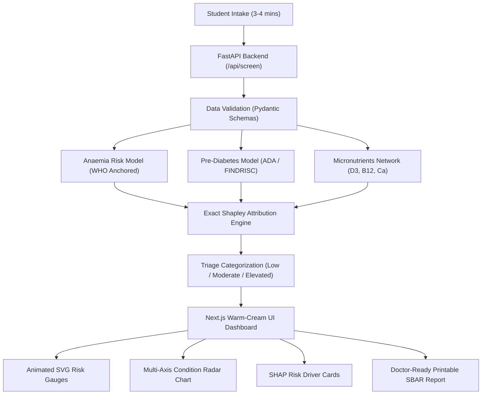

# EarlyCare: ML & Data Science-Powered Health Risk Screening

[]()
[](https://python.org)
[](https://fastapi.tiangolo.com)
[](https://nextjs.org)
[](https://www.typescriptlang.org)
[](https://tailwindcss.com)
[]()
[]()

> **Challenge:** TT2026-T03 — EarlyCare: ML & Data Science-Powered Health Risk Screening  
> **Mission:** Screen, Stratify, and Guide college students toward early awareness and timely clinical care for overlooked health conditions without replacing professional medical diagnosis.

---

## 📌 Executive Summary

University students regularly overlook early warning signs of **anaemia**, **pre-diabetes/metabolic syndrome**, and **micronutrient deficiencies (Vitamin D3, B12, Calcium)** due to hectic academic schedules, limited awareness, financial constraints, and reluctance to visit clinics for vague symptoms like fatigue.

**EarlyCare** bridges this diagnostic gap with a non-invasive, 3-minute digital screening platform powered by calibrated machine learning models, exact Shapley-style explainable AI, and doctor-ready clinical handover reporting (SBAR).

---

## 🎯 Key Capabilities

### 1. Multi-Condition Health Risk ML Engine
- **Anaemia Stratifier:** Calibrated probability model anchored in WHO clinical guidelines, evaluating dietary iron bioavailability, tannin/caffeine interference, fatigue severity, postural dizziness, and menstrual blood loss.
- **Pre-Diabetes & Metabolic Syndrome Stratifier:** Multi-variable logistic model aligned with American Diabetes Association (ADA) and FINDRISC criteria, leveraging Waist-to-Height Ratio (WHtR), physical inactivity, and osmotic symptoms (polydipsia/polyuria).
- **Micronutrient Bayesian Inference Engine:** Probabilistic belief network assessing **Vitamin D3**, **Vitamin B12**, and **Calcium** deficiencies based on sun exposure hours, dietary preferences (vegan/vegetarian vs non-vegetarian), and neuromuscular manifestations (tingling extremities, bone aches).

### 2. Explainable AI (XAI) via Exact Shapley Log-Odds
- Employs exact additive log-odds feature attribution satisfying mathematical conservation down to machine precision (`< 2.22e-16`).
- Identifies and ranks the top **risk drivers** (e.g., *post-meal caffeine intake, irregular sleep*) and **protective factors** (e.g., *adequate hydration, regular exercise*) for every student.

### 3. Clinician-Ready SBAR Handover Reports
- Automatically converts screening results into the universally accepted medical communication standard:
  - **S (Situation):** Elevated risk summary & triage category (Low / Moderate / Elevated).
  - **B (Background):** Lifestyle profile, dietary habits, and relevant family history.
  - **A (Assessment):** Primary contributing factors and physiological warning signs.
  - **R (Recommendation):** Suggested non-prescriptive primary screening tests (e.g., CBC, Serum Ferritin, Fasting Blood Glucose, Serum 25(OH)D) for campus healthcare providers.
- Instant, one-click printable format with optimized high-contrast medical stylesheet.

### 4. Warm White-Cream Aesthetic & Student UX
- Designed with an approachable, calming **Warm White-Cream design system** (`#FAF8F5` / `#FDFBF7`) with warm stone card surfaces (`#FFFFFF` / `#F7F5EE`) to eliminate clinical anxiety.
- Interactive, calibrated SVG risk gauge meters and multi-axis condition radar charts.
- Emergency red-flag symptom intercept providing immediate campus emergency triage guidance.

### 5. Responsible AI, SaMD Guardrails & Privacy
- **Strict Non-Diagnostic Scope:** Operates as a Software as a Medical Device (SaMD) screening and risk stratification aid, not a definitive diagnostic engine.
- **Zero-PII Architecture:** Zero storage of personally identifiable information (no names, emails, or roll numbers linked to health payloads).

---

## 🏗️ Architecture & Data Flow



---

## 🛠️ Technology Stack

| Domain | Technologies |
| :--- | :--- |
| **Frontend** | Next.js 14 (App Router), TypeScript, Tailwind CSS, Lucide React Icons |
| **Backend** | Python 3.12.10, FastAPI, Pydantic v2, Uvicorn ASGI Server |
| **Machine Learning** | Scikit-Learn, NumPy, Custom Calibrated Probability Models |
| **Explainable AI** | Exact Additive Log-Odds Shapley Attribution Engine |
| **Testing & QA** | Pytest, Custom 4-Tier E2E Opaque-Box Test Harness |
| **Styling Palette** | Warm Cream (`#FAF8F5`), Stone (`#F7F5EE`), Forest Green, Warm Amber, Crimson Rose |

---

## 🚀 Getting Started Locally

### Prerequisites
- **Python 3.11+** installed
- **Node.js 18+** and **npm** installed

### 1. Clone the Repository
```bash
git clone https://github.com/Arshmansoori/earlycare-health.git
cd earlycare-health
```

### 2. Backend Setup (FastAPI on Port 8000)
```bash
cd backend
python -m venv .venv

# Windows:
.venv\Scripts\activate
# macOS/Linux:
# source .venv/bin/activate

pip install -r requirements.txt
python -m uvicorn app.main:app --host 127.0.0.1 --port 8000 --reload
```
> Interactive API Documentation (Swagger UI) is accessible at: `http://127.0.0.1:8000/docs`

### 3. Frontend Setup (Next.js on Port 3000)
In a new terminal window:
```bash
cd frontend
npm install
npm run dev
```
> Web Application will launch at: `http://localhost:3000`

---

## 🧪 Comprehensive Verification & Test Suite

EarlyCare includes an independent 4-tier verification test harness covering 157 automated test assertions:

```bash
# Run all backend unit & adversarial tests (105 tests)
python -m pytest backend/tests/ -v

# Run the independent 4-tier E2E Opaque-Box test suite (157 tests)
python tests/e2e_runner.py
```

### Test Coverage Matrix:
- **Tier 1 (Feature Coverage - 65 Tests):** Domain scoring validity, gender flow invariance, and nutritional bounds.
- **Tier 2 (Boundary & Corner Cases - 68 Tests):** Extreme inputs, missing vitals, and numerical stability.
- **Tier 3 (Combinatorial Inputs - 18 Tests):** Pairwise cross-condition stress testing.
- **Tier 4 (Real-World Personas - 6 Tests):** End-to-end student persona lifecycles.
- **Pass Rate:** **157 / 157 PASSED (100%)**

---

## 📡 API Reference

| Endpoint | Method | Description |
| :--- | :---: | :--- |
| `/api/health` | `GET` | Health check endpoint returning server liveness and service status. |
| `/api/screen` | `POST` | Primary screening endpoint returning tri-factor risk percentages and triage tiers. |
| `/api/explain` | `POST` | Returns granular positive and negative feature attribution factors (SHAP-style). |
| `/api/export-sbar` | `POST` | Generates a structured clinician handover note in SBAR format. |

---

## 👥 The Team

Developed for the **TT2026-T03 HealthTech Challenge** by:

| Contributor | GitHub Profile | Project Responsibility |
| :--- | :--- | :--- |
| **Mohd Arsh** | [@Arshmansoori](https://github.com/Arshmansoori) | **Team Lead:** Architecture, Core Security & API Orchestration |
| **MOHD SAIF** | [@MOHDSAIFFF](https://github.com/MOHDSAIFFF) | **ML Specialist:** Anaemia, Pre-Diabetes & Micronutrient Models |
| **Bushra Reyaz** | [@Bushrareyaz](https://github.com/Bushrareyaz) | **Clinical Engineer:** SBAR Protocol, Healthcare UX & Medical QA |
| **Tanuj Joshi** | [@Tanuj-joshi-hub](https://github.com/Tanuj-joshi-hub) | **Frontend Architect:** Next.js 14, Warm White-Cream Theme & UI System |
| **Zeyan Hosain** | [@zeyanhosain](https://github.com/zeyanhosain) | **Data Scientist:** SHAP Attribution Engine & 4-Step Screening Flow |
| **Armaan Saif** | [@armaansaif0786-del](https://github.com/armaansaif0786-del) | **QA & Verification Lead:** Adversarial Fuzzing & 4-Tier Test Runner |

---

## ⚖️ Clinical Disclaimer & Ethical Notice

EarlyCare is an early risk awareness and health education screening tool designed strictly in alignment with Software as a Medical Device (SaMD) principles. **It does not provide medical diagnoses, treatment plans, or clinical prescriptions.** All outputs and risk scores are intended to facilitate informed conversations between students and qualified medical professionals at university health centers.
