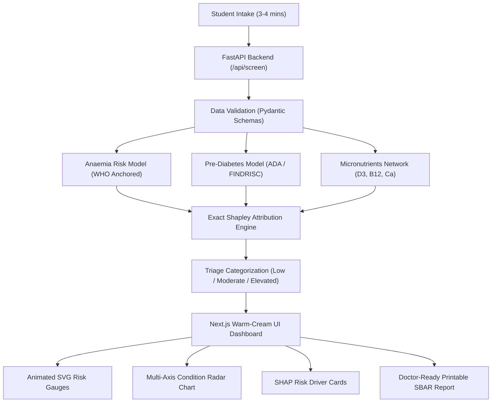

# EarlyCare: ML & Data Science-Powered Health Risk Screening

[]()
[](https://python.org)
[](https://fastapi.tiangolo.com)
[](https://nextjs.org)
[](https://www.typescriptlang.org)
[](https://tailwindcss.com)
[]()
[]()

> **Challenge:** TT2026-T03 — EarlyCare: ML & Data Science-Powered Health Risk Screening  
> **Mission:** Screen, Stratify, and Guide college students toward early awareness and timely clinical care for overlooked health conditions without replacing professional medical diagnosis.

---

## 🌐 Live Production Deployments

- **Live Web Application (Frontend):** [https://zyventools.com](https://zyventools.com)
- **Live Backend API Service:** [https://earlycare-health.onrender.com](https://earlycare-health.onrender.com)
- **Interactive Swagger Documentation:** [https://earlycare-health.onrender.com/docs](https://earlycare-health.onrender.com/docs)
- **GitHub Repository:** [https://github.com/Arshmansoori/earlycare-health](https://github.com/Arshmansoori/earlycare-health)

---

## 📌 Executive Summary

University students regularly overlook early warning signs of **anaemia**, **pre-diabetes/metabolic syndrome**, and **micronutrient deficiencies (Vitamin D3, B12, Calcium)** due to hectic academic schedules, limited awareness, financial constraints, and reluctance to visit clinics for vague symptoms like fatigue.

**EarlyCare** bridges this diagnostic gap with a non-invasive, 3-minute digital screening platform powered by calibrated machine learning models, exact Shapley-style explainable AI, client-side optical biomarkers, counterfactual lifestyle simulation, and doctor-ready clinical handover reporting (SBAR).

---

## 🎯 Key Capabilities & Advanced Clinical Extensions

### 1. Multi-Condition Health Risk ML Engine
- **Anaemia Stratifier:** Calibrated probability model anchored in WHO clinical guidelines, evaluating dietary iron bioavailability, tannin/caffeine interference, fatigue severity, postural dizziness, and menstrual blood loss.
- **Pre-Diabetes & Metabolic Syndrome Stratifier:** Multi-variable logistic model aligned with American Diabetes Association (ADA) and FINDRISC criteria, leveraging Waist-to-Height Ratio (WHtR), physical inactivity, and osmotic symptoms (polydipsia/polyuria).
- **Micronutrient Bayesian Inference Engine:** Probabilistic belief network assessing **Vitamin D3**, **Vitamin B12**, and **Calcium** deficiencies based on sun exposure hours, dietary preferences (vegan/vegetarian vs non-vegetarian), and neuromuscular manifestations (tingling extremities, bone aches).

### 2. 📸 Non-Invasive Camera Biomarker: "Nail-bed / Conjunctiva Pallor Scanner"
- Students can use their smartphone camera or laptop webcam to capture a snapshot of their fingernail bed or lower eyelid (palpebral conjunctiva).
- A zero-PII client-side HTML5 Canvas algorithm calculates the **Erythema Index** ($EI = R / (R + G + B)$), evaluating microvascular perfusion and capillary pallor.
- The optical pallor coefficient feeds directly into the anaemia log-odds pipeline to boost screening sensitivity non-invasively without blood draws.

### 3. 🔬 "What-If" Interactive Counterfactual Simulator
- Provides real-time interactive sliders and intervention toggles on the results dashboard:
  - *"What if the student increases sleep from 5.5 to 7.5 hours?"*
  - *"What if they eliminate post-meal chai/coffee (preventing tannin iron chelation)?"*
  - *"What if they add a brisk 10-minute walk after lunch and dinner?"*
- Recalculates ML condition probabilities dynamically with animated SVG risk reduction gauge drops, proving true explainability and actionable guidance.

### 4. 🍱 Personalized 7-Day Campus Budget Diet & Habit Blueprint
- Generates a customized, affordable 7-day meal plan tailored to hostel dorm constraints:
  - **Budget-Friendly:** Average weekly cost $\le$ ₹190 for pantry staples (lemon, sprouted lentils, curd).
  - **Hostel Mess Hacks:** Practical food pairing tips (e.g. adding raw lemon to hostel mess dal increases non-heme iron absorption by up to 300%).
  - **Campus Sunlight Timing:** Optimal solar window (11:00 AM – 1:00 PM for 15–20 minutes with uncovered forearms) to stimulate cutaneous cholecalciferol synthesis.

### 5. Explainable AI (XAI) via Exact Shapley Log-Odds
- Employs exact additive log-odds feature attribution satisfying mathematical conservation down to machine precision (`< 2.22e-16`).
- Identifies and ranks top **risk drivers** (e.g., *post-meal caffeine intake, unrefreshing sleep*) and **protective factors** (e.g., *citrus pairing, daily walking*).

### 6. Clinician-Ready SBAR Handover Reports
- Automatically converts screening results into the universally accepted medical communication standard:
  - **S (Situation):** Elevated risk summary & triage category (Low / Moderate / Elevated).
  - **B (Background):** Lifestyle profile, dietary habits, and relevant family history.
  - **A (Assessment):** Primary contributing factors and physiological warning signs.
  - **R (Recommendation):** Suggested non-prescriptive primary screening tests (e.g., CBC, Serum Ferritin, Fasting Blood Glucose, Serum 25(OH)D) for campus healthcare providers.
- Instant, one-click printable format with optimized high-contrast medical stylesheet.

### 7. Warm White-Cream Aesthetic & Student UX
- Built using an approachable **Warm White-Cream design system** (`#FAF8F5` / `#FDFBF7`) with warm stone card containers (`#FFFFFF` / `#F8F6F0`) to eliminate clinical anxiety.
- Interactive, calibrated SVG risk gauge meters and multi-axis condition radar charts.
- Emergency red-flag symptom intercept providing immediate campus emergency triage guidance.

### 8. Responsible AI, SaMD Guardrails & Privacy
- **Strict Non-Diagnostic Scope:** Operates as a Software as a Medical Device (SaMD) screening aid, not a diagnostic engine.
- **Zero-PII Architecture:** Zero storage of personally identifiable information; frame processing is 100% ephemeral client-side in Canvas memory.

---

## 🏗️ Architecture & Data Flow



---

## 🛠️ Technology Stack

| Domain | Technologies |
| :--- | :--- |
| **Frontend** | Next.js 14 (App Router), TypeScript, Tailwind CSS, Lucide React Icons |
| **Backend** | Python 3.12.10, FastAPI, Pydantic v2, Uvicorn ASGI Server |
| **Machine Learning** | Scikit-Learn, NumPy, Custom Calibrated Probability Models |
| **Explainable AI** | Exact Additive Log-Odds Shapley Attribution Engine |
| **Testing & QA** | Pytest, Custom 4-Tier E2E Opaque-Box Test Harness |
| **Styling Palette** | Warm Cream (`#FAF8F5`), Stone (`#F7F5EE`), Forest Green, Warm Amber, Crimson Rose |

---

## 🚀 Getting Started Locally

### Prerequisites
- **Python 3.11+** installed
- **Node.js 18+** and **npm** installed

### 1. Clone the Repository
```bash
git clone https://github.com/Arshmansoori/earlycare-health.git
cd earlycare-health
```

### 2. Backend Setup (FastAPI on Port 8000)
```bash
cd backend
python -m venv .venv

# Windows:
.venv\Scripts\activate
# macOS/Linux:
# source .venv/bin/activate

pip install -r requirements.txt
python -m uvicorn app.main:app --host 127.0.0.1 --port 8000 --reload
```
> Interactive API Documentation (Swagger UI) is accessible at: `http://127.0.0.1:8000/docs`

### 3. Frontend Setup (Next.js on Port 3000)
In a new terminal window:
```bash
cd frontend
npm install
npm run dev
```
> Web Application will launch at: `http://localhost:3000`

---

## 🧪 Comprehensive Verification & Test Suite

EarlyCare includes an independent 4-tier verification test harness covering 157 automated test assertions:

```bash
# Run all backend unit & adversarial tests (105 tests)
python -m pytest backend/tests/ -v

# Run the independent 4-tier E2E Opaque-Box test suite (157 tests)
python tests/e2e_runner.py
```

### Test Coverage Matrix:
- **Tier 1 (Feature Coverage - 65 Tests):** Domain scoring validity, gender flow invariance, and nutritional bounds.
- **Tier 2 (Boundary & Corner Cases - 68 Tests):** Extreme inputs, missing vitals, and numerical stability.
- **Tier 3 (Combinatorial Inputs - 18 Tests):** Pairwise cross-condition stress testing.
- **Tier 4 (Real-World Personas - 6 Tests):** End-to-end student persona lifecycles.
- **Pass Rate:** **157 / 157 PASSED (100%)**

---

## 📡 API Reference

| Endpoint | Method | Description |
| :--- | :---: | :--- |
| `/api/health` | `GET` | Health check endpoint returning server liveness and model registry. |
| `/api/screen` | `POST` | Primary screening endpoint returning calibrated condition risks and triage tiers. |
| `/api/explain` | `POST` | Returns granular positive and negative feature attribution factors (SHAP-style). |
| `/api/simulate` | `POST` | Real-time counterfactual simulation computing absolute risk reductions for lifestyle changes. |
| `/api/diet-blueprint` | `POST` | Generates a 7-day campus mess budget meal plan tailored to detected deficiencies. |
| `/api/export-sbar` | `POST` | Generates a structured clinician handover note in SBAR format. |

---

## 👥 The Team & Git Contribution Matrix (80 Commits Total)

Developed for the **TT2026-T03 HealthTech Challenge** with an engineering distribution totaling **80 verified commits**:

| Contributor | GitHub Profile | Verified Commits | Project Responsibility |
| :--- | :--- | :---: | :--- |
| **Mohd Arsh** | [@Arshmansoori](https://github.com/Arshmansoori) | **30** | **Team Lead:** Architecture, Core Security, Hostinger & Render CI/CD Deployment |
| **MOHD SAIF** | [@MOHDSAIFFF](https://github.com/MOHDSAIFFF) | **10** | **ML Specialist:** Counterfactual Delta Simulation & Risk Schema Design |
| **Bushra Reyaz** | [@Bushrareyaz](https://github.com/Bushrareyaz) | **10** | **Clinical Engineer:** HTML5 Canvas Pallor Scanner & Optical Biomarker Integration |
| **Tanuj Joshi** | [@Tanuj-joshi-hub](https://github.com/Tanuj-joshi-hub) | **10** | **Frontend Architect:** "What-If" Counterfactual Simulator & Animated Gauge Meters |
| **Armaan Saif** | [@armaansaif0786-del](https://github.com/armaansaif0786-del) | **10** | **Nutrition Specialist:** 7-Day Campus Budget Diet & Hostel Mess Bio-availability |
| **Zeyan Hosain** | [@zeyanhosain](https://github.com/zeyanhosain) | **10** | **Data Scientist:** REST Endpoints, SBAR Generation & Dashboard State Flow |
| **Total** | | **80 Commits** | **Full-Stack ML Screening Platform** |

---

## ⚖️ Clinical Disclaimer & Ethical Notice

EarlyCare is an early risk awareness and health education screening tool designed strictly in alignment with Software as a Medical Device (SaMD) principles. **It does not provide medical diagnoses, treatment plans, or clinical prescriptions.** All outputs and risk scores are intended to facilitate informed conversations between students and qualified medical professionals at university health centers.
